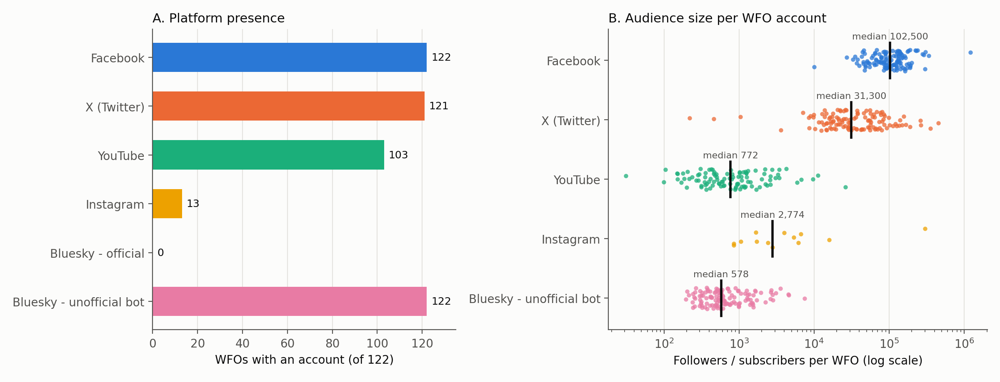
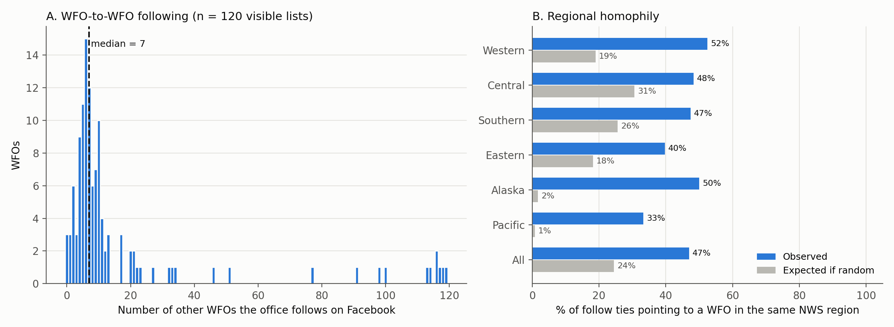
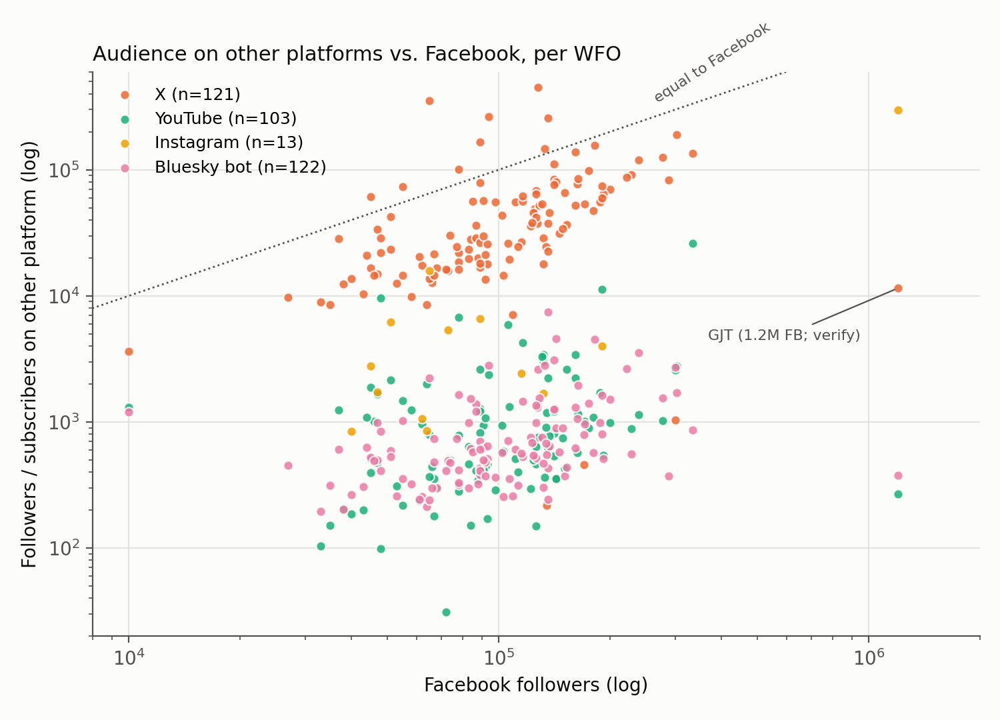

# Preliminary Analysis: NWS Weather Forecast Office Social Media (2026)

## Data sources

| Source | What it holds | Coverage |
|---|---|---|
| `Track B_ Data Collection - Sheet1.csv` (official accounts, hand-collected) | Per-WFO follower and following counts for Facebook, X, Instagram, YouTube and Bluesky; Facebook WFO-following lists; post counts for Sept 14 – Oct 14, 2026 | 122 WFOs in 47 states and territories |
| `bluesky_data/` (copied from github.com/TayCat21/CS401R) | Unofficial Bluesky bot accounts (`*.nws-bot.us`): a profile snapshot taken Oct 14, 2026, plus coded posts | 122 accounts and 68,631 posts dated Sept 11 – Nov 9, 2026 |

The unit of analysis is the **Weather Forecast Office (WFO)**. There are 122 WFOs, and each one appears exactly once in both datasets. The Bluesky handles use airport codes for 36 offices (for example, `SEA` is WFO `SEW`), so `analysis.py` maps them to WFO call signs. All 122 Bluesky bot profiles describe themselves as unofficial.

**Reproducibility.** Every number in this document is printed by `python analysis.py` and saved in `output/numbers.txt`. Each table is also saved as a CSV in `output/tables/`, and the per-WFO data is in `output/tables/wfo_master_table.csv`.

---

## RQ1: Platform presence, activity and audience

### Table 1. Platform presence and audience size (122 WFOs)

| Platform | WFOs with account | % of WFOs | Total followers | Median | Mean | Min | Max |
|---|---:|---:|---:|---:|---:|---:|---:|
| Facebook | 122 | 100.0 | 14,903,000 | 102,500 | 122,156 | 10,000 | 1,200,000 (GJT)* |
| X (Twitter) | 121 | 99.2 | 6,552,498 | 31,300 | 54,153 | 219 | 453,200 (OKX) |
| YouTube | 103 | 84.4 | 155,322 | 772 | 1,508 | 31 | 26,100 (OUN) |
| Instagram | 13 | 10.7 | 348,447 | 2,774 | 26,804 | 846 | 299,000 (GJT)* |
| Bluesky (official) | **0** | 0.0 | – | – | – | – | – |
| Bluesky (unofficial bot) | 122 | 100.0 | 114,342 | 578 | 937 | 195 | 7,476 (SEW) |

*Source: `output/tables/table1_platform_presence_audience.csv`.*

**What it shows.** Facebook and X are nearly universal: 122 and 121 WFOs have accounts. YouTube is common (103 WFOs), and Instagram is rare (13 WFOs). No WFO has an official Bluesky account. Every WFO's products are still posted to Bluesky by an unofficial bot. Facebook has the largest audiences: its median is about 3× X's and more than 100× the medians for YouTube and the Bluesky bots.

\*GJT's recorded 1.2M Facebook and 299k Instagram followers are far above every other WFO. Please check these values against the source before relying on means or totals; the medians are not affected.

**Number of official platforms per WFO** (`table_platform_combinations.csv`):
- 93 WFOs use Facebook + X + YouTube.
- 15 use Facebook + X.
- 10 use Facebook + X + YouTube + Instagram.
- 3 use Facebook + X + Instagram.
- 1 uses Facebook only.

### Table 2. Activity (posts per WFO)

| Measure | WFOs | Total posts | Median | Mean | Min | Max | Median / day |
|---|---:|---:|---:|---:|---:|---:|---:|
| Official posts, Sept 14 – Oct 14, 2026 (31 days) | 121† | 9,925 | 75 | 82.0 | 2 (HFO) | 302 (MOB) | 2.4 |
| Bluesky bot posts, Oct 1 – Oct 31, 2026 (31 days) | 122 | 45,563 | 384 | 373.5 | 38 (LMK) | 528 (AJK) | 12.4 |

*Source: `table2_activity.csv`.* †BUF has no post count recorded.

**What it shows.** A typical WFO posts about 2–3 times a day on its official page. The Bluesky bots post about 5× more often (about 12 per day) because they automatically repost every NWS product. I used October for the Bluesky window because every bot account is fully covered from Sept 30 onward. The GitHub collector's first run pulled only each account's most recent posts, so earlier days are incomplete. Despite the volume, engagement with the bots is very low. In October they received 3,300 likes, 891 reposts and 23 replies in total, and only 6.6% of posts got at least one like.

### Table 3. What the Bluesky bots post (Oct 1–31)

| Message type | Posts | Share |
|---|---:|---:|
| Forecast discussion | 15,282 | 33.5% |
| Climate / records summary | 10,835 | 23.8% |
| Warning / watch / advisory | 9,671 | 21.2% |
| Outlook / situational awareness | 3,267 | 7.2% |
| Alert update or cancellation | 2,989 | 6.6% |
| Statement / short-term forecast | 2,009 | 4.4% |
| Storm report / public information | 1,487 | 3.3% |
| Other / uncoded | 23 | 0.1% |

*Source: `table3_bluesky_message_types_oct.csv`, from the `message_type` column coded in the GitHub repo.* More than half of the bot output is routine products (forecast discussions and climate summaries). About 28% is alert-related (warnings plus alert updates).

### Figure 1. Platform presence and audience distribution

**What it shows.**
- **Panel A** counts how many of the 122 WFOs have an account on each platform. It shows the gap between Facebook and X (near-universal) and Instagram and official Bluesky (rare or absent).
- **Panel B** plots each WFO's audience on a log scale, with the black tick marking the median. Audiences on different platforms differ by orders of magnitude.

---

## RQ2: WFO-to-WFO following (Facebook)

**Network facts** (`facebook_wfo_follow_edges.csv`, `table4_follow_network_by_region.csv`):
- **Visible following lists:** 120 WFOs. ARX and BGM have hidden lists.
- **WFO→WFO follow ties:** 2,187, giving a network density of 0.151.
- **Number of WFOs each office follows:**
  - The median is 7 and the mean is 18.2.
  - The distribution is strongly skewed: a handful of offices follow almost every WFO (GJT follows 119).
  - Three offices follow no other WFO.
- **Number of WFOs following each office:**
  - The median is 18.
  - Every WFO is followed by at least one other WFO.
  - The most-followed offices are LOT (29), FWD (26), EAX (25), BYZ (25) and LZK (24).
- **Reciprocity:** 33.1% of ties are returned (710 of 2,143 eligible ties).
- **Non-WFO pages:** WFOs also follow other NWS pages 67 times. The most common are the national NWS page (11), the Eastern Region HQ (7) and River Forecast Centers.
- **Bluesky:** every bot follows exactly 1 account, so Bluesky has no WFO-to-WFO network to analyze.

### Table 4. Regional homophily in Facebook following

| NWS region | WFOs | Visible lists | Ties sent | Mean WFOs followed | % of ties to same region | % expected if random |
|---|---:|---:|---:|---:|---:|---:|
| Western | 24 | 24 | 379 | 15.8 | 52.5 | 19.0 |
| Central | 38 | 37 | 760 | 20.5 | 48.3 | 30.6 |
| Southern | 32 | 32 | 586 | 18.3 | 47.4 | 25.6 |
| Eastern | 23 | 22 | 446 | 20.3 | 39.7 | 18.2 |
| Alaska | 3 | 3 | 10 | 3.3 | 50.0 | 1.7 |
| Pacific | 2 | 2 | 6 | 3.0 | 33.3 | 0.8 |
| **All** | **122** | **120** | **2,187** | **18.2** | **47.0** | **24.5** |

**What it shows.** Each WFO's NWS region was assigned from its state; this is a derived field. Overall, 47% of follow ties go to a WFO in the same region, almost double the 24.5% expected if offices followed each other at random. The pattern is even stronger at the state level: 10.3% of ties are same-state versus 2.1% expected. This is evidence of geographic homophily, meaning offices tend to follow their neighbors.

### Figure 2. Follow-network structure

**What it shows.**
- **Panel A:** most WFOs follow 2–13 other offices. A small cluster of offices follows nearly all of them (77 or more), which pulls the mean (18.2) well above the median (7).
- **Panel B:** in every region, the observed share of same-region ties (blue) is far above what random following would produce (gray).

---

## RQ3: Multi-platform WFOs: audience and activity compared

### Table 5. Audience on each platform relative to Facebook

| Platform | WFOs | Median audience | Median as % of same WFO's Facebook | Spearman ρ with Facebook followers |
|---|---:|---:|---:|---:|
| Facebook | 122 | 102,500 | 100.0 | 1.00 |
| X | 121 | 31,300 | 33.0 | 0.56 |
| YouTube | 103 | 772 | 0.6 | 0.30 |
| Instagram | 13 | 2,774 | 3.7 | 0.46 |
| Bluesky bot | 122 | 578 | 0.6 | 0.46 |

*Source: `table5_cross_platform.csv`.*

**What it shows.**
- **Facebook vs X:** all 121 WFOs on X are also on Facebook. Facebook has the larger audience for 112 of them (93%), with a median Facebook-to-X ratio of 3.0.
- **Other platforms:** a typical WFO's YouTube or Bluesky-bot audience is under 1% of its Facebook audience.
- **Rank correlation (Spearman ρ):** offices with a large Facebook audience tend to be large elsewhere too, moderately for X (0.56) and more weakly for YouTube (0.30).
- **Activity:** activity tracks audience only weakly. The rank correlation is 0.29 between Facebook followers and Facebook posts, and 0.16 between official posts and Bluesky bot posts.
- **All four official platforms:** 10 WFOs are on Facebook, X, YouTube and Instagram: BYZ, EKA, FFC, GJT, LBF, LCH, LOX, PSR, RIW and VEF.

### Figure 3. Cross-platform audience vs Facebook

**What it shows.** Each dot is one WFO on one platform, plotted on log scales. Dots below the dotted line have a smaller audience than that WFO's Facebook page. X sits closest to the line, while YouTube and the Bluesky bots sit 2–3 orders of magnitude below it. The upward drift of each cloud reflects the positive correlations in Table 5.

---

## Caveats
- **Values to verify:** GJT's Facebook (1.2M) and Instagram (299k) follower counts are extreme outliers.
- **Which platform the post counts cover:** the CSV's `# Of Posts Sept 14 - Oct 14` column doesn't name a platform. It sits beside the Facebook columns, so I treated it as Facebook. Please confirm.
- **Different time windows:** the official and Bluesky activity windows are both 31 days but don't overlap exactly (Sept 14 – Oct 14 vs Oct 1 – 31), so compare them as rates.
- **Rounded counts:** follower counts recorded as "k"/"M" were converted to whole numbers (125k → 125,000), so they keep the rounding of the original entry.
- **Reported vs parsed follow counts:** the CSV's own "# of WFOs this account follows" matches the parsed list for 99 of 120 WFOs. The differences come mostly from non-WFO NWS pages (RFCs, region HQs) that were counted in the CSV. The network uses the parsed names.
- **Bluesky collection gaps:** the bot data shows dips on some days (for example Oct 2, Oct 9 and Oct 29), which may be collection gaps. If so, the October Bluesky totals slightly understate activity.
