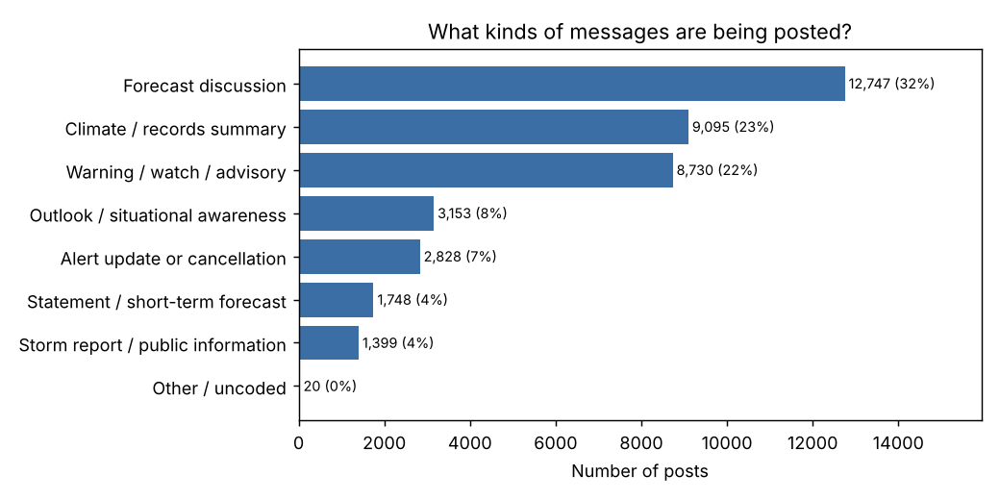
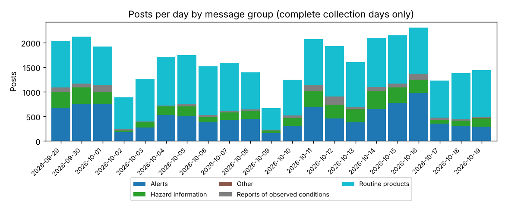
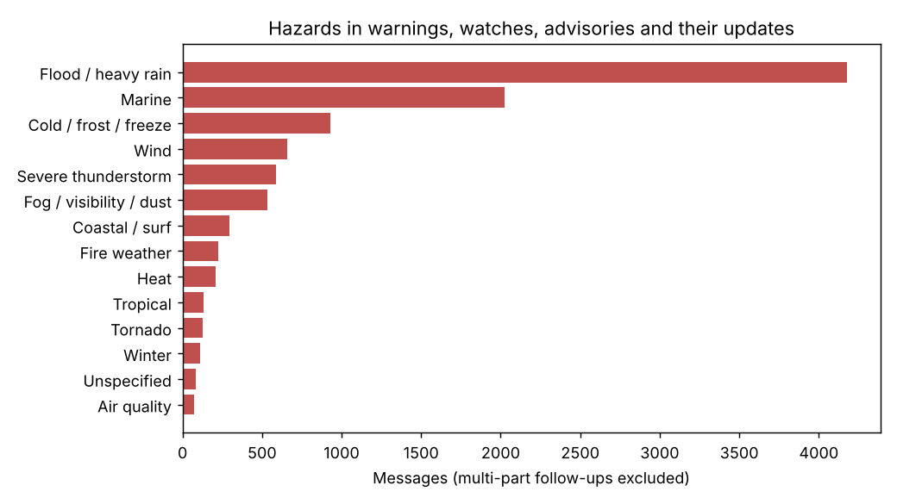
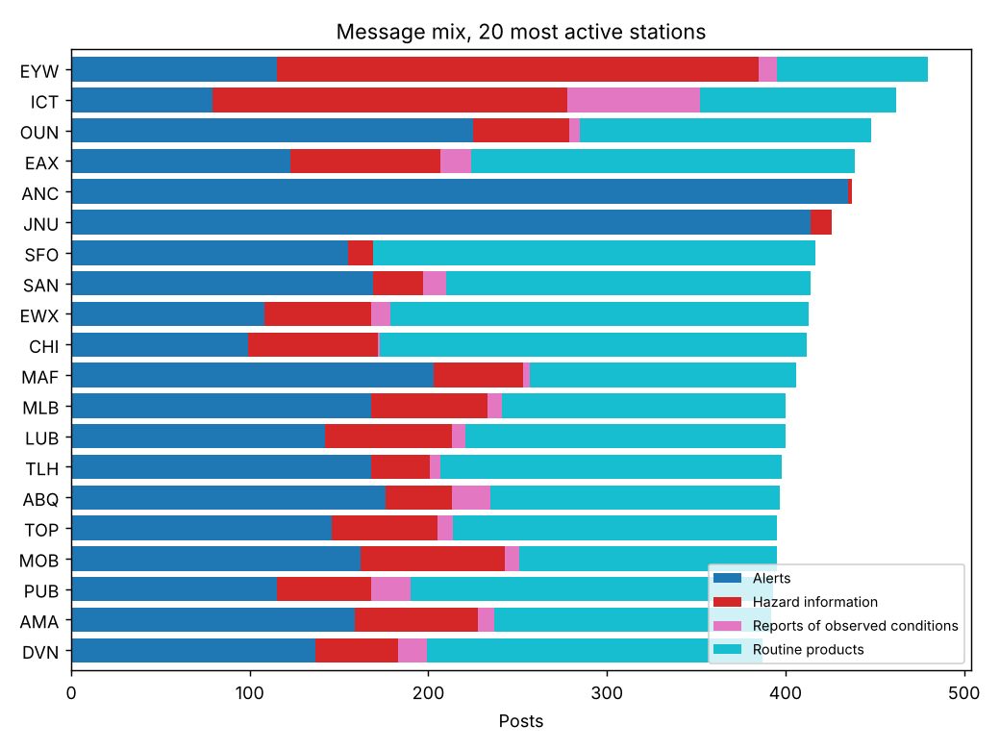

# Bluesky emergency-services posts: coding summary

*Updated 2026-10-21 16:35 UTC*

- **39,720** posts from **122** accounts
- Posts dated **2026-09-11** to **2026-10-20**
- Multi-part follow-up posts (2/3, 3/3...): 1,406

## Message types

| Message type | Posts | Share |
|---|---:|---:|
| Forecast discussion | 12,747 | 32.1% |
| Climate / records summary | 9,095 | 22.9% |
| Warning / watch / advisory | 8,730 | 22.0% |
| Outlook / situational awareness | 3,153 | 7.9% |
| Alert update or cancellation | 2,828 | 7.1% |
| Statement / short-term forecast | 1,748 | 4.4% |
| Storm report / public information | 1,399 | 3.5% |
| Other / uncoded | 20 | 0.1% |

## Posting over time

Only days fully covered by the daily collection are shown. The first run pulled each account's latest posts only, so earlier days are incomplete.

## Hazards in alerts

## Differences between stations

Full per-station tables are in the `station_by_type` and `station_by_group_pct` sheets of `bluesky_posts_coded.xlsx`.
